<p align="center">
  
</p>

# 🔬 Awesome Digital Pathology & Whole-Slide Imaging (WSI)

<p align="center">
  <a href="https://github.com/ishandutta2007/Awesome-Awesome-Awesome"></a>
  <a href="https://discord.gg/jc4xtF58Ve"></a>
  <a href="https://github.com/ishandutta2007/Awesome-Digital-Pathology-Whole-Slide-Imaging/stargazers"></a>
  <a href="https://github.com/ishandutta2007/Awesome-Digital-Pathology-Whole-Slide-Imaging/network/members"></a>
  <a href="https://github.com/ishandutta2007/Awesome-Digital-Pathology-Whole-Slide-Imaging/issues"></a>
  <a href="https://github.com/ishandutta2007/Awesome-Digital-Pathology-Whole-Slide-Imaging/pulls"></a>
  <a href="https://github.com/ishandutta2007/Awesome-Digital-Pathology-Whole-Slide-Imaging/blob/main/LICENSE"></a>
  <a href="https://github.com/ishandutta2007"></a>
</p>

---

## 📌 Executive Summary & Ecosystem Overview

> **A comprehensive, SEO-optimized, community-curated directory of clinical Image Management Systems (IMS), gigapixel slide viewers, digital pathology AI algorithms, WSI decoding runtimes, and foundation models for precision oncology and bioimage informatics.**

Welcome to the **Awesome Digital Pathology & Whole-Slide Imaging (WSI)** resource guide! This knowledge hub tracks the state of the art in **computational pathology**, **clinical whole-slide scanning**, **pyramidal deep-zoom image processing**, and **foundation-model deep learning**.

Whether you are handling multi-gigabyte histological image files (`.svs`, `.ndpi`, `.mrxs`, `.scn`, `.tiff`, DICOM WSI), setting up self-hosted pathology web viewers, benchmarking weakly supervised Multiple Instance Learning (MIL) models, or deploying enterprise clinical telepathology workflows, this repository catalogs both top-tier commercial solutions and premier open-source toolkits.

---

## 📑 Table of Contents

- [📊 Sector Overview & Market Dynamics](#-sector-overview--market-dynamics)
- [🏢 SaaS & Hosted Commercial Platforms](#-saas--hosted-commercial-platforms)
- [💻 Open-Source GitHub Projects](#-open-source-github-projects)
  - [🚀 High-Throughput WSI Decoders & Processing Runtimes](#-high-throughput-wsi-decoders--processing-runtimes)
  - [🔬 Interactive Slide Viewers & Annotation Suites](#-interactive-slide-viewers--annotation-suites)
  - [🤖 Computational Pathology, AI & Foundation Models](#-computational-pathology-ai--foundation-models)
  - [🏥 DICOM WSI & Clinical Interoperability Standards](#-dicom-wsi--clinical-interoperability-standards)
- [🤝 How to Contribute](#-how-to-contribute)
- [💖 Support & Sponsor](#-support--sponsor)
- [📈 Star History](#-star-history)
- [⚖️ Disclaimer & Regulatory Notice](#️-disclaimer--regulatory-notice)

---

## 📊 Sector Overview & Market Dynamics

The global **Digital Pathology Market** is currently valued between **$1.3 billion and $1.6 billion** and is projected to surge to **$2.86 billion – $5.75 billion** over the next decade at a compound annual growth rate (**CAGR of 12.5% to 18.5%**), catalyzed by FDA primary diagnostic clearances, high-throughput whole-slide scanner automation, and hospital-wide laboratory information system (LIS) modernizations.

```
       ┌────────────────────────────────────────────────────────┐
       │   Digital Pathology Market Dynamics ($1.3B - $1.6B)    │
       └───────────────────────────┬────────────────────────────┘
                                   │
         ┌─────────────────────────┴─────────────────────────┐
         ▼                                                   ▼
┌─────────────────────────────────┐       ┌─────────────────────────────────┐
│     CONCENTRATED HARDWARE       │       │       FRAGMENTED SOFTWARE       │
│  ~50% Market Share Dominance    │       │     High Innovation & M&A       │
│  Danaher / Leica, Roche,        │       │  AI Biomarker Apps, IMS Suites, │
│  Philips, Hamamatsu             │       │  Foundation Models, Startups    │
└─────────────────────────────────┘       └─────────────────────────────────┘
```

The sector features a **hybrid, moderately concentrated market structure**:
1. **Concentrated Hardware & Scanning Core:** The foundational slide scanner and primary clinical infrastructure tier is heavily consolidated. A small cadre of multinational giants—Danaher (Leica Biosystems), F. Hoffmann-La Roche, Royal Philips, and Hamamatsu Photonics—command nearly 50% of cumulative hardware market revenues.
2. **Fragmented Software, Cloud IMS & AI Tier:** In contrast, image management software (IMS), spatial biomarker quantification, multiplexed bioimaging, and multimodal deep learning models remain dynamic and fragmented. Rapid innovation from specialized startups is driving aggressive M&A consolidation—exemplified by Agilent acquiring Proscia for $240M+ and Roche acquiring PathAI for up to $1.05B.

---

## 🏢 SaaS & Hosted Commercial Platforms

Below is a structured analysis of enterprise cloud platforms, clinical IMS vendors, and diagnostic AI suites, ranked in **descending order by company scale (market capitalization / enterprise valuation)**:

| Platform | Company Size (Valuation / Revenue) | Pricing | Free Tier / Trial Limit | Key Capabilities & Diagnostic Focus |
| :--- | :--- | :--- | :--- | :--- |
| **[Roche NAVIFY Digital Pathology](https://roche.com)** | 🌐 ~$282B Market Cap / ~$75B Revenue | 💰 Commercial clinical deployment starting from ~$45,000/year (LIS & scanner interface modules) | ⏳ 30-day guided institutional trial (requires clinical site onboarding & demo dataset) | 🏥 Enterprise cloud-integrated workflow software uniting high-throughput slide scanning, NAVIFY algorithm suite, and hospital LIS for clinical diagnostics. |
| **[Leica Biosystems Aperio (eSlide Manager & Aperio HALO AP)](https://leicabiosystems.com)** | 🌐 Parent Danaher ~$162B Market Cap (Leica ~$1B Revenue) | 💰 Enterprise server tier starting from ~$30,000/year (multi-seat clinical license) | ⏳ 30-day institutional trial for Aperio eSlide Manager (up to 25 test slides with full viewer features) | 🔬 Enterprise web-based slide management, viewing, and telepathology ecosystem engineered for multi-site health systems and `.svs` slide workflows. |
| **[Philips IntelliSite Pathology Solution](https://philips.com)** | 🌐 ~$27B Market Cap / ~$20B Revenue | 💰 Enterprise hospital deployment starting from ~$50,000/year (Image Management System tier) | ⏳ 60-day structured hospital pilot evaluation program (limited to 5 clinician seats & preloaded study sets) | 🏥 End-to-end clinical digital pathology suite combining ultra-fast whole-slide scanners, scalable IMS, and FDA-cleared diagnostic case viewers. |
| **[Sectra Digital Pathology](https://sectra.com)** | 🌐 ~$5.5B Market Cap / ~$360M Revenue | 💰 Subscription starting from ~$35,000/year (PACS integration & diagnostic pathology workstation) | ⏳ 30-day clinical sandbox trial (includes demo PACS connection and 50 anonymized whole-slide studies) | 🩻 Enterprise diagnostic pathology PACS and VNA platform uniting radiology and pathology imaging in a single vendor-neutral clinical viewer. |
| **[Hamamatsu NanoZoomer Cloud / NDP.serve](https://hamamatsu.com)** | 🌐 ~$3.5B Market Cap / ~$1.4B Revenue | 💰 Software server license starting from ~$15,000/year (NDP.serve base streaming server) | ⏳ 30-day trial license for NDP.view / NDP.serve (limited to local server hosting & 10 concurrent slide connections) | ⚡ Whole-slide imaging ecosystem and cloud/network slide-serving software engineered for high-throughput `.ndpi` scanning, telepathology, and multi-user viewing. |
| **[PathAI (AISight)](https://pathai.com)** | 🌐 ~$1.05B Valuation (Acquired by Roche) / ~$50M Revenue | 💰 Enterprise biopharma / clinical lab tier starting from ~$25,000/year (AISight IMS subscription) | ⏳ 14-day interactive web sandbox demo (includes 10 sample breast/prostate whole-slide sessions) | 🤖 Cloud-based digital pathology IMS and AI-powered biomarker quantification platform supporting clinical trials, biopharma research, and diagnostic workflows. |
| **[Paige.ai (Paige Platform & Virchow Ecosystem)](https://paige.ai)** | 🌐 ~$239M Total VC Funding / ~$25M Revenue | 💰 Clinical AI diagnostic module tier starting from ~$20,000/year (per-lab diagnostic subscription) | ⏳ 14-day cloud evaluation trial for Paige Platform (includes 20 AI-assisted prostate/breast diagnostic slide analyses) | 🧬 Clinical-grade computational pathology SaaS and foundation-model ecosystem offering FDA-cleared diagnostic AI modules and cloud whole-slide viewing. |
| **[Proscia Concentriq](https://proscia.com)** | 🌐 ~$240M Acquisition (Agilent) / ~$18M TTM Revenue | 💰 Enterprise laboratory tier starting from ~$18,000/year (Concentriq AP / LS base cloud subscription) | ⏳ 30-day guided evaluation sandbox (limited to 3 concurrent user accounts and 100 hosted test slides) | ☁️ Cloud-native enterprise digital pathology platform and AI orchestrator uniting whole-slide management, clinical collaboration, and diagnostic AI apps. |
| **[Indica Labs HALO & HALO Link](https://indicalab.com)** | 🌐 ~$20M Revenue / Private Enterprise | 💰 Academic/lab desktop license starting from ~$10,000/seat/year (HALO base quantitative analysis) | ⏳ 14-day full-feature trial license (single workstation, includes core tissue segmentation & cell analysis modules) | 🔬 Quantitative digital pathology image analysis and browser-based slide management platform widely used in spatial biology, oncology, and IHC research. |
| **[Visiopharm](https://visiopharm.com)** | 🌐 ~$15M Revenue (Acquired by Grundium) | 💰 Research analysis APP tier starting from ~$12,000/seat/year (modular AI tissue analysis package) | ⏳ 14-day evaluation license (single user, access to 2 standard oncology biomarker APPs on local slides) | 🧬 AI-driven precision pathology and spatial biology software suite offering automated tissue segmentation, multiplexing analysis, and enterprise slide management. |

---

## 💻 Open-Source GitHub Projects

Explore the open-source digital pathology ecosystem, sorted strictly by **GitHub Stars_Count (descending)**. Every project includes live social badges linking to its stargazer community.

- **[libvips](https://github.com/libvips/libvips)** [](https://github.com/libvips/libvips/stargazers)  
  ⚡ *Ultra-fast, low-memory demand-driven C/C++ image processing engine.* Widely used by pathology slide servers and cloud pipelines to generate Deep Zoom (DZI), pyramidal TIFFs, and OME-TIFFs from gigapixel histology slides.

- **[MONAI](https://github.com/Project-MONAI/MONAI)** [](https://github.com/Project-MONAI/MONAI/stargazers)  
  🩺 *The premier PyTorch-based open-source framework for healthcare AI.* Features dedicated whole-slide imaging modules (`monai.apps.pathology`) for tumor segmentation, patch-level multiple instance inference, and multi-scale tissue training.

- **[OpenSeadragon](https://github.com/openseadragon/openseadragon)** [](https://github.com/openseadragon/openseadragon/stargazers)  
  🔍 *The industry-standard pure JavaScript web viewer for high-resolution zoomable images.* Powers smooth pan-and-zoom visualization of gigapixel histopathology slides and DeepZoom pyramids across modern web browsers.

- **[napari](https://github.com/napari/napari)** [](https://github.com/napari/napari/stargazers)  
  🖼️ *Fast, interactive multi-dimensional bioimage viewer in Python.* Backed by Qt and VisPy, supporting extensions like `napari-lazy-openslide` and `napari-spatialdata` for exploring multiplexed immunofluorescence and gigapixel tissue sections.

- **[CLAM](https://github.com/mahmoodlab/CLAM)** [](https://github.com/mahmoodlab/CLAM/stargazers)  
  🤖 *Pioneering weakly supervised Multiple Instance Learning (MIL) framework.* Clustering-constrained Attention Multiple Instance Learning for whole-slide disease classification, subtyping, and attention heatmap generation without pixel annotations.

- **[QuPath](https://github.com/qupath/qupath)** [](https://github.com/qupath/qupath/stargazers)  
  🔬 *The gold-standard cross-platform bioimage analysis desktop suite for digital pathology.* Fluid gigapixel slide navigation, cell/nuclei detection, machine-learning pixel classification, TMA dearraying, and Groovy/Python script automation.

- **[StarDist](https://github.com/stardist/stardist)** [](https://github.com/stardist/stardist/stargazers)  
  🎯 *Deep learning star-convex object detection for 2D/3D microscopy and histology.* De facto standard for nuclear instance segmentation in dense H&E and multi-channel immunofluorescence whole-slide images.

- **[UNI](https://github.com/mahmoodlab/UNI)** [](https://github.com/mahmoodlab/UNI/stargazers)  
  🧠 *General-purpose pathology foundation model (Nature Medicine).* Pre-trained on 100M+ gigapixel histopathology tissue patches via self-supervised learning, excelling at pan-cancer diagnostic classification and cellular phenotyping across 30+ clinical tasks.

- **[HoVer-Net](https://github.com/vqdang/hover_net)** [](https://github.com/vqdang/hover_net/stargazers)  
  🧬 *Simultaneous nuclear instance segmentation and cell-type classification.* Utilizes horizontal and vertical distance gradients to separate overlapping nuclei and classify lymphocytes, epithelial, stromal, and necrotic cells in H&E WSIs.

- **[TRIDENT](https://github.com/mahmoodlab/TRIDENT)** [](https://github.com/mahmoodlab/TRIDENT/stargazers)  
  🛠️ *Scalable computational pathology preprocessing toolkit.* Automates multi-resolution tissue segmentation, pen-marking and artifact filtering, and high-throughput patch tiling across gigapixel slide cohorts.

- **[Prov-GigaPath](https://github.com/prov-gigapath/prov-gigapath)** [](https://github.com/prov-gigapath/prov-gigapath/stargazers)  
  🌐 *Whole-slide pathology foundation model by Providence & Microsoft Research (Nature).* Pre-trained on 1.3 billion pathology tiles from over 170,000 clinical whole-slide images for slide-level biomarker prediction and subtyping.

- **[TIAToolbox](https://github.com/TissueImageAnalytics/tiatoolbox)** [](https://github.com/TissueImageAnalytics/tiatoolbox/stargazers)  
  🧰 *Comprehensive computational pathology suite from the Warwick TIA Centre.* Offers end-to-end Python APIs for multi-vendor WSI loading, tissue masking, stain normalization (Macenko, Vahadane), patch extraction, and pre-trained classification models.

- **[OpenSlide](https://github.com/openslide/openslide)** [](https://github.com/openslide/openslide/stargazers)  
  📄 *Foundational C library for vendor-neutral digital pathology.* Provides an efficient, uniform interface for reading multi-resolution pyramidal slide formats including Aperio (`.svs`), Hamamatsu (`.ndpi`), Leica (`.scn`), MIRAX (`.mrxs`), and generic tiled TIFFs.

- **[histolab](https://github.com/histolab/histolab)** [](https://github.com/histolab/histolab/stargazers)  
  🧪 *Reproducible Python library for digital pathology image preprocessing.* Offers intuitive pipelines for tissue localization, background removal, random/grid tile extraction, and slide thumbnail generation.

- **[HistoQC](https://github.com/choosehappy/HistoQC)** [](https://github.com/choosehappy/HistoQC/stargazers)  
  🔍 *Automated quality-control pipeline for digital pathology cohorts.* Detects out-of-focus blur, glass slide pen marks, air bubbles, coverslip folds, and batch staining variations across large-scale WSI studies.

- **[HistoCartography](https://github.com/BiomedSciAI/histocartography)** [](https://github.com/BiomedSciAI/histocartography/stargazers)  
  🕸️ *Graph analytics and cell topology toolkit for computational pathology.* Converts histological tissue architecture into cell graphs and tissue networks for graph neural network (GNN) modeling and spatial biology discovery.

- **[deep-histopath](https://github.com/CODAIT/deep-histopath)** [](https://github.com/CODAIT/deep-histopath/stargazers)  
  🔬 *Deep learning reference pipeline for histopathologic lymph node metastasis classification.* Built on TensorFlow for automated detection of metastatic breast cancer lesions in whole-slide lymph node sections.

- **[SLIM](https://github.com/ImagingDataCommons/slim)** [](https://github.com/ImagingDataCommons/slim/stargazers)  
  🌐 *Zero-footprint web viewer for DICOM Whole Slide Imaging.* Open-source web platform for visualizing DICOM microscopy images, structured annotations, algorithm heatmaps, and DICOMweb federated archives.

- **[Patch-GCN](https://github.com/mahmoodlab/Patch-GCN)** [](https://github.com/mahmoodlab/Patch-GCN/stargazers)  
  📊 *Context-aware survival prediction using patch-based Graph Convolutional Networks (MICCAI).* Models spatial interrelationships among tissue regions to predict cancer patient outcomes from gigapixel slides.

- **[Digital Slide Archive (DSA) & HistomicsUI](https://github.com/DigitalSlideArchive/digital_slide_archive)** [](https://github.com/DigitalSlideArchive/digital_slide_archive/stargazers)  
  🖥️ *Full-stack enterprise web slide management & analysis platform.* Powered by Girder and `large_image`, enabling web-based multi-gigapixel slide streaming, user annotation tools, and server-side Docker algorithm orchestration.

- **[pathology-whole-slide-data](https://github.com/DIAGNijmegen/pathology-whole-slide-data)** [](https://github.com/DIAGNijmegen/pathology-whole-slide-data/stargazers)  
  ⚡ *High-speed whole-slide data reader and batch iterator.* Designed by the Radboud Diagnostic Image Analysis Group (DIAG) to rapidly stream annotated WSI patches directly into deep-learning training loops.

- **[marugoto](https://github.com/KatherLab/marugoto)** [](https://github.com/KatherLab/marugoto/stargazers)  
  🧬 *Deep-learning toolbox for digital biomarker prediction from histology.* End-to-end framework for predicting gene mutations, microsatellite instability (MSI), and patient survival directly from routine H&E whole-slide images.

- **[TiffSlide](https://github.com/Bayer-Group/tiffslide)** [](https://github.com/Bayer-Group/tiffslide/stargazers)  
  ☁️ *Cloud-native `tifffile`-based drop-in replacement for OpenSlide Python.* Developed by Bayer, enabling zero-copy NumPy array loading, S3/GCS remote streaming via `fsspec`, and memory-efficient slide parsing.

- **[WSIDicom](https://github.com/imi-bigpicture/wsidicom)** [](https://github.com/imi-bigpicture/wsidicom/stargazers)  
  🏥 *Python library for DICOM Whole Slide Imaging interoperability.* Reads, decodes, tiles, and converts vendor proprietary slides into standardized DICOM WSI objects for PACS integration and European Bigpicture initiatives.

- **[Cytomine](https://github.com/cytomine/cytomine)** [](https://github.com/cytomine/cytomine/stargazers)  
  🤝 *Collaborative open-source bioimaging web ecosystem.* Enables distributed teams to annotate gigapixel pathology slides with shared ontologies, review consensus diagnoses, and execute containerized computer vision models via REST APIs.

---

## 🤝 How to Contribute

We actively welcome contributions from clinical pathologists, computer vision researchers, data scientists, and open-source software authors! 🚀

1. 🍴 **Fork the repository** on GitHub.
2. 🌿 **Create a feature branch**:
   ```bash
   git checkout -b add/new-pathology-tool
   ```
3. 📝 **Add or update an entry** in `README.md` following our structured standard:
   - Tool/Platform name with official hyperlink.
   - For open-source repos: include the official GitHub Stars_Badge linking to `/stargazers`.
   - Concise 1–2 sentence description of key technical capabilities and target formats.
   - For SaaS tools: include starting tier pricing and specific trial limits.
4. 📬 **Submit a Pull Request** with a brief summary of why the addition benefits the digital pathology community.

---

## 💖 Support & Sponsor

If you find this curated resource valuable for your research, clinical department, or engineering workflows, please consider supporting the project:

- ⭐ **Star this repository** to help other researchers and engineers discover it!
- 🍴 **Fork and share** the repo with colleagues on LinkedIn, X/Twitter, and specialized Slack/Discord communities.
- ☕ **Sponsor on GitHub**: If you'd like to support ongoing curation, open-source maintenance, and ecosystem benchmarking, you can sponsor through the **[GitHub Sponsors Dashboard](https://github.com/sponsors/ishandutta2007)**! Sponsorship tiers include README profile badges, project shoutouts, and prioritized inclusion of new toolkits.

> *Thank you to all open-source maintainers, computational biologists, and pathology practitioners advancing the frontier of reproducible, accessible cancer diagnostics!* 🙏

---

## 📈 Star History

[](https://www.star-history.com/#ishandutta2007/Awesome-Digital-Pathology-Whole-Slide-Imaging&type=date&legend=top-left)

---

## ⚖️ Disclaimer & Regulatory Notice

- **Community-Curated Resource:** This repository is an informational, community-maintained directory and does not constitute medical advice or an endorsement of any commercial platform or open-source software.
- **Diagnostic & Regulatory Compliance:** Open-source digital pathology packages (`QuPath`, `OpenSlide`, `TIAToolbox`, `MONAI`, etc.) are developed for **Research Use Only (RUO)** or educational benchmarking. They are not FDA 510(k) cleared, CE-IVD marked, or certified for primary clinical diagnosis in patient care unless explicitly validated within regulatory-approved laboratory-developed test (LDT) protocols. Always rely on certified clinical diagnostic platforms and licensed pathologists.
- **Patient Privacy & De-Identification:** Whole-slide images generated from clinical tissue specimens frequently contain embedded protected health information (PHI) in slide labels or barcode metadata. Ensure all slides undergo strict de-identification (e.g., via `WSIDicom` anonymization profiles) and comply with HIPAA, GDPR, and institutional IRB standards prior to cloud transfer or public sharing.

---

<p align="center">
  <b>Made with ❤️ for pathologists, computational pathology researchers, biomedical engineers, spatial biologists, and open-source contributors worldwide.</b><br/>
  <i>Let's make whole-slide imaging more open, interoperable, and reproducible.</i>
</p>
